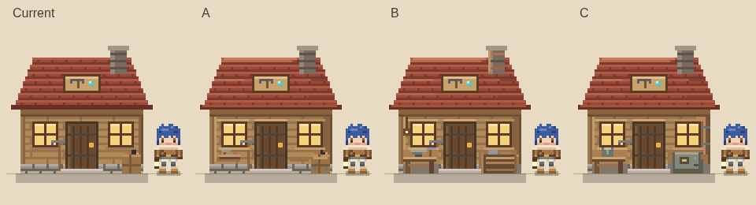
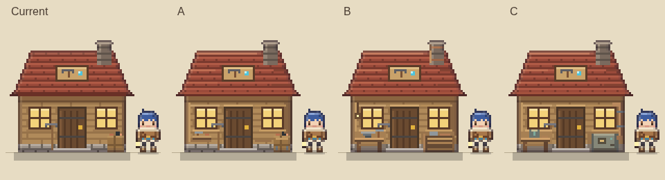

# G2 공방 외관 시안

**검토용 Draft. 정식 게임 미적용.** 기준: develop `ab0ad8c464319bbaf2735e4a46998050878f17f0` (G0·G1).

기존 공방과 A(기존 개선), B(장인의 작업장), C(복원 기술 작업장)를 비교한다. **B를 우선 추천**하며, 최종 선택은 사용자와 ChatGPT의 검토 후 결정한다.





- [평가 및 검증 보고서](G2_REPORT.md)
- [비교 HTML](G2-workshop-compare.html): 내려받아 브라우저에서 열거나 로컬 서버로 제공. GitHub 파일 화면에서는 HTML 소스가 표시된다.
- [모든 PNG](screenshots/) · [검증 기록](screenshots/verification.json) · [갤러리 검증](screenshots/gallery-verification.json)

## 실제 게임 화면 바로 보기

| 조건 | 기존 | A | B | C |
|---|---|---|---|---|
| PC classic | [PNG](screenshots/pc-classic-current.png) | [PNG](screenshots/pc-classic-A.png) | [PNG](screenshots/pc-classic-B.png) | [PNG](screenshots/pc-classic-C.png) |
| PC v2 | [PNG](screenshots/pc-v2-current.png) | [PNG](screenshots/pc-v2-A.png) | [PNG](screenshots/pc-v2-B.png) | [PNG](screenshots/pc-v2-C.png) |
| 모바일 classic | [PNG](screenshots/mobile-classic-current.png) | [PNG](screenshots/mobile-classic-A.png) | [PNG](screenshots/mobile-classic-B.png) | [PNG](screenshots/mobile-classic-C.png) |
| 모바일 v2 | [PNG](screenshots/mobile-v2-current.png) | [PNG](screenshots/mobile-v2-A.png) | [PNG](screenshots/mobile-v2-B.png) | [PNG](screenshots/mobile-v2-C.png) |
| PC 저녁 classic | [PNG](screenshots/dusk-classic-current.png) | [PNG](screenshots/dusk-classic-A.png) | [PNG](screenshots/dusk-classic-B.png) | [PNG](screenshots/dusk-classic-C.png) |
| PC 저녁 v2 | [PNG](screenshots/dusk-v2-current.png) | [PNG](screenshots/dusk-v2-A.png) | [PNG](screenshots/dusk-v2-B.png) | [PNG](screenshots/dusk-v2-C.png) |

## 파일

- `proposal.js`: 기존 painter 함수를 사용하는 독립 픽셀 시안. 불러오기만 해서는 게임에 적용되지 않는다.
- `G2-workshop-compare.html`: 정적 PNG 선택 갤러리. 게임 스크립트·저장 API를 호출하지 않는다.
- `capture.cjs`: 로컬 실제 게임을 격리 Chromium에서 실행하고 `TD.sheet.base`만 메모리에서 교체한다.
- `check-images.py`: Pillow를 이용해 PNG 차이가 공방 영역 안에만 있는지 검증.
- `check-gallery.cjs`: PC·모바일 폭에서 이미지 로드/넘침/저장 비접근 검증.
- `screenshots/`: 원본 64×58 4장, 6배 확대 4장, 비율표 2장, 실제 화면 24장과 검증 JSON.
- `PLAN.md`, `G2_REPORT.md`: 범위·제작 절차·판단 근거.

## 로컬 보기와 재촬영

저장소 루트에서:

```sh
python3 -m http.server 8000
# http://localhost:8000/docs/design/graphics-g2-workshop/G2-workshop-compare.html
```

재촬영은 Node.js, Playwright, Chromium이 필요하다. Playwright를 임시 디렉터리 또는 기존 개발 환경에 설치해 모듈 경로를 제공한다. 게임의 package.json은 변경하지 않는다.

```sh
# 설치되어 있지 않은 경우에만:
npm install --prefix /tmp/g2-capture-deps playwright
NODE_PATH=/tmp/g2-capture-deps/node_modules CHROMIUM=/usr/bin/chromium node docs/design/graphics-g2-workshop/capture.cjs
NODE_PATH=/tmp/g2-capture-deps/node_modules CHROMIUM=/usr/bin/chromium node docs/design/graphics-g2-workshop/check-gallery.cjs
```

Chromium 위치가 다르면 `CHROMIUM`으로 지정한다. 스크립트는 임시 로컬 HTTP 서버를 자동 종료한다. 캡처는 **현재 체크아웃의 게임 코드**를 사용하므로 다른 커밋에서 실행하면 결과가 달라질 수 있다. 이번 기록의 기준 커밋은 위에 명시했다.

게임은 시작 전부터 메모리 저장소만 보며, 실제 브라우저 저장소에는 검사용 sentinel만 둔다. 캡처의 각 조건에서 sentinel 보존과 실제 sessionStorage 비어 있음을 검증한다. 외부 Google Fonts CSS는 캡처 도구에서 빈 응답으로 대체해 로컬 폰트로 표시한다. 게임 HTML/CSS 파일은 수정하지 않는다.

추가 픽셀 비교: `python3 docs/design/graphics-g2-workshop/check-images.py` (Pillow 필요). 전체 회귀 테스트 출력은 `screenshots/regression.log`에 보존했다.
