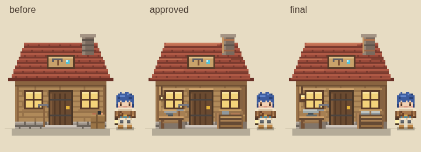
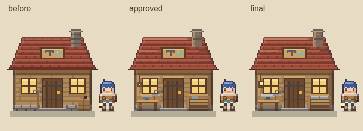

# G2 최종 적용 — 승인된 B안

사용자가 승인한 B안에 모바일 가독성 보완을 적용했다. 기존 시안과 검증 기록은 상위 폴더에 그대로 보존했다. 여기의 `before`는 G0·G1 develop의 공방, `approved`는 승인 당시 B안, `final`은 **게임이 부팅하면서 생성한 정식 공방 이미지**다.





## 모바일 가독성 보완

- **모루:** 윗면을 9픽셀 폭과 2픽셀 두께로 넓히고 어두운 허리와 받침을 구분했다. 나무 작업대 위에서 금속의 실루엣이 읽힌다.
- **재료 선반:** 상단에 밝은 회색 금속 묶음 두 개를 배치하고 아래의 갈색 판재와 분리했다. 1픽셀 세부를 보지 않아도 재료 종류가 구분된다.
- **작업등:** 어두운 테두리 안의 따뜻한 유리를 2×2픽셀로 확대했다. 기존 조명만 사용하며 새 광원이나 발광 시스템은 추가하지 않았다.
- 붉은 지붕, 목조 외벽, 왼쪽 작업대, 오른쪽 선반, 기존 굴뚝과 구리 보강재를 유지했다.

PC에서는 장식이 과밀하지 않고, 모바일 2배 화면에서는 모루의 넓은 윗면과 선반의 회색/갈색 구분이 승인 당시보다 명확하다. 저녁에는 작은 망치보다 모루·선반의 큰 형태가 주로 읽힌다. G1 캐릭터 대비 공방 너비 4배, 캔버스 높이 약 2.64배의 기존 비율은 같다. 모바일은 Chromium 에뮬레이션이며 실제 휴대폰 실측은 아니다.

## 실제 게임 렌더링

| 조건 | 변경 전 | 승인 B | 최종 적용 |
|---|---|---|---|
| PC classic 낮 | [PNG](screenshots/pc-classic-before.png) | [PNG](screenshots/pc-classic-approved.png) | [PNG](screenshots/pc-classic-final.png) |
| PC v2 낮 | [PNG](screenshots/pc-v2-before.png) | [PNG](screenshots/pc-v2-approved.png) | [PNG](screenshots/pc-v2-final.png) |
| 모바일 classic 낮 | [PNG](screenshots/mobile-classic-before.png) | [PNG](screenshots/mobile-classic-approved.png) | [PNG](screenshots/mobile-classic-final.png) |
| 모바일 v2 낮 | [PNG](screenshots/mobile-v2-before.png) | [PNG](screenshots/mobile-v2-approved.png) | [PNG](screenshots/mobile-v2-final.png) |
| PC classic 저녁 | [PNG](screenshots/dusk-pc-classic-before.png) | [PNG](screenshots/dusk-pc-classic-approved.png) | [PNG](screenshots/dusk-pc-classic-final.png) |
| PC v2 저녁 | [PNG](screenshots/dusk-pc-v2-before.png) | [PNG](screenshots/dusk-pc-v2-approved.png) | [PNG](screenshots/dusk-pc-v2-final.png) |
| 모바일 classic 저녁 | [PNG](screenshots/dusk-mobile-classic-before.png) | [PNG](screenshots/dusk-mobile-classic-approved.png) | [PNG](screenshots/dusk-mobile-classic-final.png) |
| 모바일 v2 저녁 | [PNG](screenshots/dusk-mobile-v2-before.png) | [PNG](screenshots/dusk-mobile-v2-approved.png) | [PNG](screenshots/dusk-mobile-v2-final.png) |

원본/6배 확대: [기존](screenshots/sprite-before-6x.png), [승인 B](screenshots/sprite-approved-6x.png), [최종](screenshots/sprite-final-6x.png). 실제 화면 24장, 원본·확대 6장, G1 비율표 2장으로 총 32장이다.

## 구현 범위와 보존 조건

정식 게임 변경은 **`js/topdown/sprites.js`의 `tdBaseSprite()` 하나**다. 다른 스프라이트, 렌더러, 충돌, 상호작용, 저장, 진행 로직, UI, 기본 classic 설정은 수정하지 않았다. v2는 기존 마무리 함수를 그대로 사용한다. 크기 64×58, 기준점 (32,54), 문 14×20 및 계단, 창문 유리, 바닥 그림자는 유지한다. G3·G4 작업은 없다.

상위 `proposal.js`, 기존 PNG·로그와 G2_REPORT는 당시 기록이다. 기존 캡처 스크립트는 현재 게임 함수를 참조하므로 당시 결과 재현에는 시안 커밋 `5fae5fe4310f1ba0bccb55ba27ee40e873ab1ce2`를 사용한다. 이 폴더의 새 캡처는 `baseline-sprite.js`로 이전 공방을 고정하여 세 버전을 재현한다.

## 검증 및 재현

- `tests/chunks/22.js`: 실제 스프라이트의 규격·경계·문/계단·창문·그림자·모루 대비·재료 대비·작업등 면적·classic 기본값·v2 크기, 10개 계약. 적용 전 모루/재료/작업등 3개가 실패하는 것을 확인한 뒤 구현했다. 기존 테스트는 삭제하거나 완화하지 않았다.
- [렌더 기록](screenshots/verification.json): 12개 기기/스타일/그림 조합에서 상태 JSON 불변, 저장 격리, 출입구 픽셀 및 창문 광원 중심점 유지. 각 조합에서 낮·저녁 촬영.
- [게임 동작 기록](screenshots/game-verification.json): 4개 기기/스타일에서 **실제 localStorage**로 이전 외관 저장 → 최종 코드 로드 → 재저장 → 새로고침. 골드/철/티켓과 저장 버전 보존. 네 방향 키보드, 벽 접근, 공방 열기·닫기, 모바일 조이스틱 포인터 드래그 통과. 공방의 기존 '들어가기'는 제작/개발 패널을 여는 동작이며 새 실내는 추가하지 않았다.
- [화면 차이 기록](screenshots/image-verification.json): 16쌍의 PNG에서 공방 사각형 외부 변화 없음. 기존 건물·캐릭터·지형·UI가 같은 조건에서 동일하게 보인다.
- 전체 회귀 및 CI 결과는 아래 검증 완료 기록과 PR #26에서 확인한다.

```sh
node tests/run-chunks.cjs 22
# Playwright + Chromium, Python Pillow 필요. Chromium 경로는 CHROMIUM 환경변수로 변경 가능.
node docs/design/graphics-g2-workshop/final/capture.cjs
node docs/design/graphics-g2-workshop/final/check-game.cjs
python3 docs/design/graphics-g2-workshop/final/check-images.py
npm test
```

촬영 조건: 시드 20261101, PC 1280×800/DPR1/3배, 모바일 390×844/DPR3/2배, 플레이어 공방 대비 (+0.45,+0.65), 낮 0ms/밝기0.10, 저녁240000ms/밝기0.34. 지형과 미니맵의 점진적 캐시를 준비한 뒤 고정 프레임을 촬영한다. 외부 Google Fonts CSS는 빈 응답으로 대체하므로 로컬 대체 글꼴을 사용한다. 캡처는 메모리 저장소, 동작 검증은 별도의 격리 컨텍스트에 있는 실제 저장소를 사용한다.

로컬 smoke 테스트는 Playwright 번들 브라우저가 없고 다운로드 도메인이 차단되어 시스템 `/usr/bin/chromium`을 지정해 **기존 테스트 본문 그대로** 실행했다. CI는 저장소의 기존 브라우저 설치 절차를 사용한다.

## 로컬 검증 완료 기록

2026-11-03 재시작 환경에서 전체 회귀 테스트를 다시 실행하여 **2,773/2,773 통과, 실패 0, 종료 코드 0**을 확인했다. [전체 로그](screenshots/regression.log). `NODE_PATH=/workspace/gacha-factory-prototype/node_modules node --max-old-space-size=5120 tests/regression.test.js`로 실행했다. 기존 browser-smoke도 시스템 Chromium으로 재확인하여 통과했다. 독립 코드·이미지 검토에서 차단 문제는 없었다. PR CI와 병합/배포 상태는 PR #26 및 GitHub Actions의 해당 커밋 기록을 따른다.
