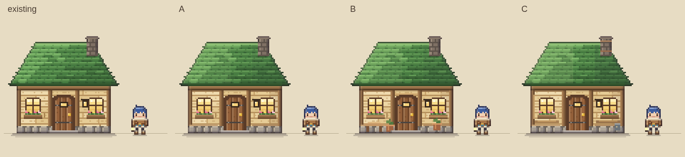
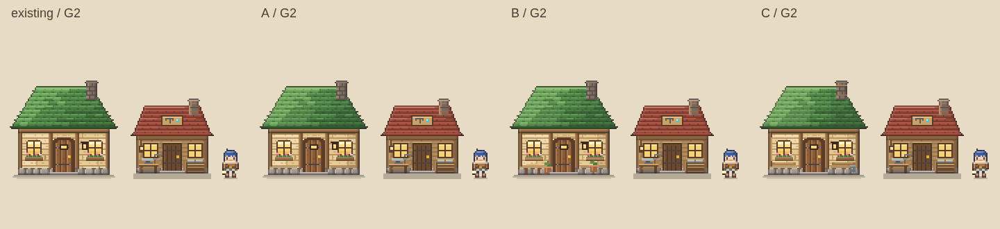

# G3 집 외관 비교 제안

**정식 게임 적용 전 검토 자료**다. `origin/develop` `9ddf955`의 집을 기준으로 A·B·C를 실제 게임 화면에서 비교했다. [비교 페이지](G3-house-compare.html), [평가 보고서](G3_REPORT.md), [시안 코드](proposal.js).




| 안 | 방향 | 핵심 변화 |
|---|---|---|
| 기존 | 현재 집 | 초록 지붕·따뜻한 쌍창·꽃상자·굴뚝 |
| A | 최소 정리 | 지붕 좌상광/우측 그늘, 처마 아래 깊이, 벽/기단 경계 |
| B | 아늑한 생활 | A + 낮은 현관 의자, 작은 화분 두 개, 따뜻한 문 위 반사색 |
| C | G2 재질 정합 | 녹색 지붕 유지, 구리 굴뚝 띠·목재 창 아래 판·작은 금속 생활 상자 |

B를 후속 적용 후보로 권한다. 따뜻한 창과 꽃상자를 유지하면서 거주 흔적이 가장 분명하다. 모바일에서 낮은 의자와 화분은 작게 읽히므로 적용 단계에서는 장식 대비를 한 번 더 검토할 수 있다. 승인 전에는 기본 그림을 바꾸지 않는다.

## 실제 게임 화면

| 조건 | 기존 | A | B | C |
|---|---|---|---|---|
| pc classic 낮 | [existing](screenshots/pc-classic-existing.png) | [A](screenshots/pc-classic-A.png) | [B](screenshots/pc-classic-B.png) | [C](screenshots/pc-classic-C.png) |
| pc v2 낮 | [existing](screenshots/pc-v2-existing.png) | [A](screenshots/pc-v2-A.png) | [B](screenshots/pc-v2-B.png) | [C](screenshots/pc-v2-C.png) |
| mobile classic 낮 | [existing](screenshots/mobile-classic-existing.png) | [A](screenshots/mobile-classic-A.png) | [B](screenshots/mobile-classic-B.png) | [C](screenshots/mobile-classic-C.png) |
| mobile v2 낮 | [existing](screenshots/mobile-v2-existing.png) | [A](screenshots/mobile-v2-A.png) | [B](screenshots/mobile-v2-B.png) | [C](screenshots/mobile-v2-C.png) |
| pc classic 저녁 | [existing](screenshots/dusk-pc-classic-existing.png) | [A](screenshots/dusk-pc-classic-A.png) | [B](screenshots/dusk-pc-classic-B.png) | [C](screenshots/dusk-pc-classic-C.png) |
| pc v2 저녁 | [existing](screenshots/dusk-pc-v2-existing.png) | [A](screenshots/dusk-pc-v2-A.png) | [B](screenshots/dusk-pc-v2-B.png) | [C](screenshots/dusk-pc-v2-C.png) |
| mobile classic 저녁 | [existing](screenshots/dusk-mobile-classic-existing.png) | [A](screenshots/dusk-mobile-classic-A.png) | [B](screenshots/dusk-mobile-classic-B.png) | [C](screenshots/dusk-mobile-classic-C.png) |
| mobile v2 저녁 | [existing](screenshots/dusk-mobile-v2-existing.png) | [A](screenshots/dusk-mobile-v2-A.png) | [B](screenshots/dusk-mobile-v2-B.png) | [C](screenshots/dusk-mobile-v2-C.png) |

PC 1280×800/DPR1, 모바일 390×844/DPR3. classic·v2 각각 낮 0.10/저녁 0.34 고정. 시드 20261101, 같은 기기/스타일 안에서는 위치·카메라·상태·배율이 같다. 새 격리 컨텍스트의 메모리 저장소만 사용한다. 외부 폰트 CSS는 차단하며 시스템 대체 글꼴로 촬영했다. 모바일은 Chromium 에뮬레이션이다.

## 크기와 보존 계약

집은 **84×73**, G1 캐릭터는 16×22(머리~장화 21px), 집 렌더 기준점은 **(42,70)**다. `tdDrawSprite(..., anchorY=3)`이 73px 높이 중 아래 그림자 3행을 보정한다. 문 16×25(프레임 포함), 계단 (31,68) 22×2, 좌우 창 (15,45)/(59,45) 11×11, 등불 (54,46) 6×7, 그림자 70~72행은 각 스타일의 기존 픽셀을 그대로 복원한다. v2는 `tdHouseSpriteV2()`의 곡선 지붕 타일·나뭇결·석재·외곽선을 출발점으로 쓰며 classic으로 대체하지 않는다.

게임 소스·기본 classic·충돌·문 위치·실내·조명 시스템·세이브 버전/필드·G2·G4를 수정하지 않았다. `proposal.js`에는 자동 실행 훅이 없고, 캡처가 `TD.sheet.house`의 메모리 이미지만 바꾼다. 구역 배치는 캡처용 고정 상태이며 실제 월드 생성 제안이 아니다.

원본/최근접 6배 확대는 `screenshots/sprite-{classic|v2}-{existing|A|B|C}-{84x73|6x}.png`, G1 비율표는 `ratio-{classic|v2}.png`, G2 비교는 `alongside-g2-{classic|v2}.png`다. 실제 화면 32장 + 원본/확대 16장 + 비율/정합 4장 = **52 PNG**.

## 재현·검증

```sh
NODE_PATH=/opt/codex/runtimes/codex-primary-runtime/dependencies/node/node_modules node docs/design/graphics-g3-house/capture.cjs
python3 docs/design/graphics-g3-house/check-images.py
NODE_PATH=/workspace/gacha-factory-prototype/node_modules node --max-old-space-size=5120 tests/regression.test.js
```

[렌더 계약 기록](screenshots/verification.json): 16개 기기/스타일/안 조합의 규격·문·계단·양쪽 창·등불·정수 경계·충돌/상호작용 지도·상태 JSON 불변·네이티브 저장소 격리와 콘솔 오류 0건. 256회 렌더와 미니맵 청크 준비 후 촬영했다. [PNG 차이](screenshots/image-verification.json): 24쌍 모두 집 사각형 밖 변화 0. 이 검증은 조명 시스템 확장이나 실제 모바일 기기 검증을 뜻하지 않는다.

[집/저장 검증](screenshots/game-verification.json): classic/v2의 4안 모두 기존 house 상호작용, 실내 입장/퇴장, 같은 실내 스프라이트, 문 앞 복귀를 확인했다. 별도 격리 브라우저의 실제 localStorage로 골드137/철42/티켓7·saveVersion1 저장 후 새로고침 복원을 확인했다. `check-game.cjs`로 재현한다. 이 검사는 기존 함수를 호출하는 계약 검사이며 전체 키보드/터치 플레이 테스트는 아니다.

## 검증 완료 (2026-11-03)

- 전체 회귀 **2,773/2,773 통과, 실패 0**, 종료 코드 0. [로그](screenshots/regression.log).
- 기존 browser-smoke 통과. 저장소 테스트 본문 변경 없이 Playwright `chromium.launch`에 시스템 `/usr/bin/chromium` 경로만 주입했다.
- CI와 같은 Biome 명령 통과(종료 코드 0). 기존 설정의 폴더 ignore 경고 3건, 기존 smoke의 template 정보 2건이며 파일 수정은 하지 않았다.
- 비교 HTML의 기기/스타일/빛 8조합에서 이미지 10개씩 로드, 스크립트 오류 0. 실제 모바일 저녁 v2 화면도 직접 확인했다.
- `git diff origin/develop -- js tests index.html`은 비어 있다. 제안/캡처/보고서만 추가하며 정식 게임 소스는 그대로다.
