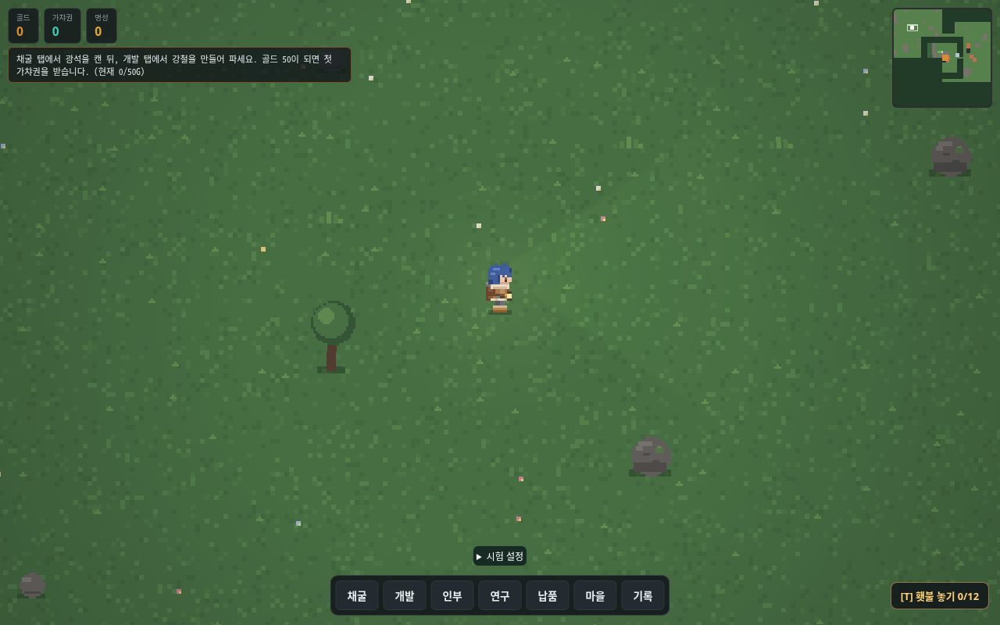
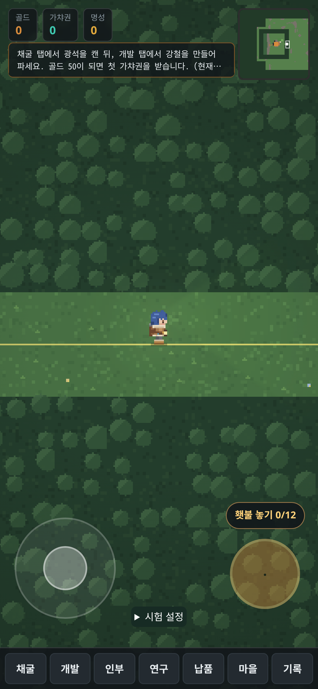

# PR #5 독립 검토 수정 보고서

대상: `codex/worldgen-stage3` → `develop`, 기존 Draft PR #5. 수정 전 기준은 `1b4dff8`, develop 비교 기준은 `f95d9ac`입니다. 256×256 시험 모드만 다루며 2048 월드는 활성화하지 않습니다.

## 수정 내용

- **H1**: 생성 광맥을 마을 도로/풀포기 키에서 제외합니다. 기존 마을 광맥·거점·개방 구역 변경은 정상 반영합니다. 생성 광맥이 추가되어도 groundMap, 렌더 청크, 도로, 풀포기 객체를 유지하는 회귀 테스트를 추가했습니다. 기존 점진적 청크 캔버스 그리기를 유지합니다.
- **H2**: 시험 모드 일꾼은 절대 좌표의 1/4 단위 격자에서 점진적 A* 경로를 찾고, 실제 발 충돌 검사로 이동합니다. 마을과 외곽 사이 통로를 포함하며, 막혔을 때 순간이동/ghost 보정 대신 재탐색합니다. 모든 일꾼이 프레임당 256 노드 및 약 2ms의 협력적 탐색 예산을 공유합니다. 단일 앵커 계산/노드 확장 도중에는 예산을 조금 초과할 수 있습니다. 동·남·북 광맥 실제 이동 시뮬레이션에서 snaps=0, 한 스텝 이동 거리 상한, 도착을 검증합니다. 도착 시 광맥을 바라보는 방향도 복원합니다.
- **M3**: 미니맵은 `map.types`를 읽지 않고 이미 만들어진 청크를 프레임당 최대 한 개씩 반영합니다. 미지 영역은 어둡게 남고, 개요 캔버스는 최대 256×256 픽셀입니다. 미니맵 갱신만으로 새 데이터 청크를 만들지 않습니다.
- **M4**: 숨은 광맥 목록을 배열 정체성/길이에 따라 Set으로 캐시하고 탐사는 `worldMinesNear` 공간 질의를 사용합니다. 일꾼 배치 키는 기존 마을 광맥과 생성 광맥 진행 변경 revision을 사용하므로 매 프레임 모든 생성 광맥 문자열을 만들지 않습니다.
- **M5**: seed 7의 `gen:v1:mine:-5:7`은 보호 숲 안쪽으로 통로가 연결되어 실제 고립되어 있음을 재현했습니다. **v1 결과는 수정하지 않습니다.** 신규 시험 저장에만 생성기 v2를 사용하고 북·남쪽 경계 광맥의 연결 통로를 바깥 격자로 연결합니다. 해당 v2 광맥의 접근 및 진행 저장/복원을 검증합니다. 기존 v1 저장은 계속 v1으로 열리며 자동 변환하지 않습니다.
- 저장 키 판별 함수를 `js/storagekeys.js`로 통합했습니다. `saveVersion: 1`과 `.worldgen256.v1` 저장 키는 유지합니다. 키의 v1은 저장 형식이며 생성기 버전과 별개입니다. 기존 일반 저장·개발용 저장은 시험 모드에서 쓰지 않습니다.
- 시험 패널을 접을 수 있게 하단으로 옮겼습니다. 직접 걸어서 통로에 들어갈 때 복귀점을 기록하며, 외곽에서 복귀점이 없는 저장은 왕복 버튼을 비활성화하고 이유를 표시합니다.
- 브라우저 검증은 실제 시간의 키보드/터치 입력으로 통로 이동 및 채굴을 수행합니다. 테스트/측정 기본 출력은 `work/`이며 추적된 스크린샷을 덮어쓰지 않습니다.

`sprites.js`, `style.js`, `hires.js`, 타일 그리기 수식, Pages/배포 워크플로, 원본 저장소는 이번 수정에서 변경하지 않았습니다. 신규 기능 테스트는 `tests/chunks/20.js`, 결과 출력은 기존 `99.js`를 유지합니다.

## 생성기 호환성과 남은 제한

1. v1 전체 월드 해시와 기존 저장/광맥 ID를 유지합니다. v1 고립 광맥은 여전히 접근할 수 없습니다. 이를 해결하려면 사용자가 명시적으로 선택하는 별도 이전 정책이 필요하며 이번 작업에서 저장을 자동 변환하지 않습니다.
2. 새 시험 월드는 v2 ID(`gen:v2:*`)를 사용합니다. v1/v2 각각 저장·재로드 시 버전이 유지되고, 다른 버전 ID를 저장 변경 기록에 섞는 것은 거부합니다.
3. 경로 탐색은 렌더러 상태이며 저장하지 않습니다. 재접속 시 일꾼은 작업장 출발 동작부터 다시 이동하지만 광맥 배치/진행 참조는 유지됩니다. 막힌 경로에서는 기다리거나 재탐색하며 순간이동하지 않습니다.
4. 미니맵은 탐색한 지형을 점진적으로 표시하므로 처음부터 전체 지형을 보여주지 않습니다. 향후 2048 월드에서는 멀리 떨어진 발견 청크의 개요 보존/축소 정책을 추가 검토해야 합니다.

## 검증 방법

```sh
NODE_OPTIONS=--max-old-space-size=5120 npm test
node -r /workspace/work/stage3/work/system-chromium.cjs tests/browser-smoke.cjs
node tests/worldgen-stage3-browser.cjs
# 수정 전후 비교 도구(일회성, PR #5 커밋 9e4875f에만 있음):
#   https://github.com/Bellsier/gacha-factory-development/blob/9e4875fe13cea2efaeee63e0719fcd16fc02b5e9/tools/measure-pr5-review.cjs
#   https://github.com/Bellsier/gacha-factory-development/blob/9e4875fe13cea2efaeee63e0719fcd16fc02b5e9/tools/measure-pr5-workers.cjs
```

Smoke의 preload는 Playwright에 환경의 `/usr/bin/chromium`과 `--no-sandbox`를 지정하는 로컬 보조 파일입니다. CI는 기존 Playwright 설치 절차를 사용합니다.

H1, H2, M3, M4, M5, 도착 방향 및 공유 탐색 예산은 수정 전 실패를 확인한 뒤 수정했습니다. 중간 전체 회귀 실행은 최종 검토 수정 반영을 위해 중단했으며 통과로 집계하지 않습니다. 독립 코드 재검토에서 도착 방향·시간 예산 수정이 확인됐습니다.

## 동일 조건 성능 비교

모두 Linux headless Chromium에서 실행한 에뮬레이션입니다. PC/Chromebook/모바일 실제 기기를 측정한 것은 아닙니다. PC 1280×800 DPR1, Chromebook 1366×768 DPR1, 모바일 390×844 DPR3 및 touch, 각각 CPU 1×/4×입니다.

- develop 일반, 수정 전 PR 일반/시험, 수정 후 PR 일반/시험의 5개 변형 × 6개 환경 = 30회.
- 동일한 중간 진행 fixture, 시험 모드는 **seed 7 생성기 v1**로 맞춥니다. 신규 v2 기능 검증과 성능 비교를 구분합니다.
- 초기 로딩 뒤 1초 대기, 20초 실제 키보드/터치 입력. 시험 경로는 마을 x9,y0에서 통로를 거쳐 (16,0), (16,4), (28,4) 방향이며 일반 모드는 (6,2)↔(9.5,2)입니다. 느린 프로필은 같은 시간 동안 도달 거리가 짧을 수 있으므로 방문 청크와 원시 위치를 함께 기록합니다.
- 프레임은 requestAnimationFrame 간격, 바닥은 tdEnsureGround, 청크 그리기는 tdChunkWork, 그리기 목록은 tdDrawList, 게임 틱은 tickLoop 시간을 감쌉니다. 바닥 재생성은 groundMap 객체 교체 횟수입니다. 초기 로딩 비용은 이 표에 포함되지 않습니다.
- 일꾼 부하 별도 비교: 동일 seed7/v1 북쪽 철 광맥에 13명 배치, 30초, 수정 전후 × 6환경. 사전 전체 물질화를 수행하므로 데이터 스트리밍과 경로 탐색 비용을 구분합니다. 30초 도착 수는 장거리 보행 완료 보증이 아니며 기능 시뮬레이션과 별개입니다.
- 성능 측정 중 전체 회귀 테스트를 병행하지 않습니다. 각 조건은 한 번 측정하므로 실행 간 잡음이 포함되며 실제 하드웨어의 절대 성능을 뜻하지 않습니다.

최종 수치와 검증 결과는 아래에 기록합니다.

## 최종 로컬 검증

원본 로그·원시 측정과 나머지 스크린샷은 저장소 크기를 줄이려고 develop에 옮기지 않았습니다(PR #16). 아래 링크는 PR #5의 마지막 커밋 `9e4875f`에 있는 원본을 가리킵니다.

- 최종 전체 회귀 **2,355 / 2,355 통과, 실패 0**: [최종 로그](https://github.com/Bellsier/gacha-factory-development/blob/9e4875fe13cea2efaeee63e0719fcd16fc02b5e9/docs/recovery/worldgen-stage3-review/regression-final.log.gz). 최초 로컬 실행 2,354개 통과 기록은 [이전 로그](https://github.com/Bellsier/gacha-factory-development/blob/9e4875fe13cea2efaeee63e0719fcd16fc02b5e9/docs/recovery/worldgen-stage3-review/regression.log.gz)에 보존했습니다.
- 실제 Chromium browser smoke 통과: [로그](https://github.com/Bellsier/gacha-factory-development/blob/9e4875fe13cea2efaeee63e0719fcd16fc02b5e9/docs/recovery/worldgen-stage3-review/smoke.log).
- 실제 Chromium PC·모바일 키보드/터치 이동, 채굴, 저장/재로드, 원본 저장 보호 검증 통과. 페이지 오류 0: [결과](https://github.com/Bellsier/gacha-factory-development/blob/9e4875fe13cea2efaeee63e0719fcd16fc02b5e9/docs/recovery/worldgen-stage3-review/browser-results.json).
- 동·남·북 일꾼 시뮬레이션 각각 snaps=0 및 실제 도착 통과. 마을/시험 구역 경계 충돌, 생성 광맥 발견·확보·자원 및 일꾼 참조, 기존 v1/v2 저장 재로드, classic/v2 마을 타일 픽셀 동등성과 음수 좌표 청크 연결 테스트도 통과했습니다.
- [30개 조건 성능표](PERFORMANCE.md)와 [원시 측정](https://github.com/Bellsier/gacha-factory-development/blob/9e4875fe13cea2efaeee63e0719fcd16fc02b5e9/docs/recovery/worldgen-stage3-review/movement-raw.json.gz). 전체 바닥 재생성은 시험 모드 **2회 → 0회**입니다. 수정 후 시험 모드 6개 조건 모두 청크 경계 통과를 확인했습니다. 수정 전 Chromebook 시험 1×의 최초 실행은 경계 진입 전 측정 시간이 끝나 별도 재측정했습니다.
- 브라우저 측정은 실제 Chromium 실행이지만 PC/Chromebook/모바일 프로필과 CPU 감속은 에뮬레이션입니다. 실제 휴대폰·Chromebook 기기 테스트는 수행하지 않았습니다.

## 실제 Chromium 스크린샷

스크린샷은 최종 기능 검증 중 캡처했으며 이전 추적 파일과 별도 경로에 보관합니다. 마을/연결부/서북쪽/채굴 후 재접속의 PC·모바일 자료 8장입니다.




[전체 스크린샷 8장](https://github.com/Bellsier/gacha-factory-development/tree/9e4875fe13cea2efaeee63e0719fcd16fc02b5e9/docs/recovery/worldgen-stage3-review/screenshots) (이 저장소에는 위 2장만 둡니다)

일꾼 부하 측정 도구의 첫 실행은 렌더용 투영 객체에서 `snaps`를 읽어 집계가 NaN이 되는 계측 오류가 있었습니다. 실제 `TD.workerSim.byId` 상태를 읽도록 고친 뒤 12개 조건 모두 재측정했습니다. 잘못된 계측 결과는 최종 표의 순간이동 검증에 사용하지 않습니다.

이번 추가 코드 커밋은 `284dfa1`(H1 캐시 유지), `379037c`(H2·M3–M5·저장 키/조작 검증)입니다. 기존 이력을 재작성하지 않았습니다. [변경 파일 목록](https://github.com/Bellsier/gacha-factory-development/blob/9e4875fe13cea2efaeee63e0719fcd16fc02b5e9/docs/recovery/worldgen-stage3-review/FILES.txt)은 수정 전 `1b4dff8` 대비 목록입니다.

Chromium 13명 동시 이동 재측정은 수정 전 순간이동 5–13회, 수정 후 6개 프로필 모두 **0회**입니다. 다만 수정 후 30초 내 도착은 0명이며, 장거리 보행·탐색 대기는 남아 있습니다. [표](PERFORMANCE.md) / [원시 자료](https://github.com/Bellsier/gacha-factory-development/blob/9e4875fe13cea2efaeee63e0719fcd16fc02b5e9/docs/recovery/worldgen-stage3-review/workers-raw.json.gz).

## 첫 GitHub CI 실패와 재현

`09d7b97`의 [첫 Node 22 CI](https://github.com/Bellsier/gacha-factory-development/actions/runs/39763575286)는 **2353/2354, 실패 1**이었습니다. 실패 항목은 기존 `Task71: it stands next to the base on open ground`이며 새 월드 생성 검사들은 통과했습니다. [실패 요약 로그](https://github.com/Bellsier/gacha-factory-development/blob/9e4875fe13cea2efaeee63e0719fcd16fc02b5e9/docs/recovery/worldgen-stage3-review/ci-first-failure.log).

Task71은 무작위 초기 광맥/마을 배치에서도 첫 제작소가 무조건 거점에서 Chebyshev 거리 1에 놓인다고 가정했습니다. seed0 LCG 배치에서 거리 1의 후보들이 광맥·시설·도로에 막히면 실제 게임은 다음 열린 링의 `(4,-2)`를 선택합니다(거점 `(2,0)`, 감정소 `(2,2)`, 박물관 `(0,-1)`). 이 현상은 수정 전 `1b4dff8`과 수정 후에서 동일하게 재현했습니다. 제작소 배치 게임 로직을 바꿀 문제가 아니라 기존 테스트의 무작위 전제 문제입니다.

기존 Task71의 **거리 1 기대값과 모든 검사는 유지**하고, 인접 칸이 열린 seed1 배치를 테스트 입력으로 고정했습니다. 테스트 로더의 선택적 RNG 주입은 이 시나리오에서만 사용합니다. 별도로 `20.js`에 seed0 저장 fixture를 사용하여 인접 링이 막혀 있을 때 시설을 침범하지 않고 다음 링의 열린 칸에 실제 건설되는 검사를 추가했습니다. 게임 코드·기존 마을·저장 형식은 이 CI 수정에서 변경하지 않았습니다. CI를 단순 재실행해 우연히 통과시키는 방식으로 처리하지 않았습니다.

Task71 테스트 수정 후 로컬 전체 회귀를 다시 실행하여 **2355/2355, 실패 0**을 확인했습니다. 기존 검사 12개와 막힌 링 검사의 개별 실행도 통과했습니다. 독립 읽기 재검토에서 기대값 약화나 게임 코드 변경이 없음을 확인했습니다.

## H2 최종 회귀 수정 — 남쪽 연결 통로

기준 `c14ac28`. Claude의 기존 H1/M3/M4/M5·성능 검토는 재사용하며, 별도 성능 행렬과 스크린샷 비교는 반복하지 않았습니다.

- **원인:** 연결 통로의 소유 범위 `-0.5 ≤ y < 0.5`와 발이 설 수 있는 범위 `|y| ≤ 0.44` 사이에 남쪽 폭 0.06의 막힌 띠가 있습니다. A*의 0.08 균등 샘플은 `(14.125, 0.375) → (14.125, 0.625)`를 통과 가능하다고 오판했습니다. 남쪽뿐 아니라 남쪽을 우회하는 서쪽 경로도 영향을 받습니다. 실제 이동은 시간 간격에 따라 이 띠에 멈추거나 건너뛸 수 있어 해당 경로를 허용해서는 안 됩니다.
- **최소 수정:** `worldchunks.js`에 기존 통로 경계를 같은 값의 공유 상수로 옮기고 `terrain.js`가 이를 사용합니다. `worldnavigation.js`는 기존 충돌 샘플에 더해 통로의 정확한 경계 교차점과 구간 내부를 검사합니다. 단순히 샘플 간격을 더 작게 만드는 방식에 의존하지 않습니다. 지형·통로 폭·생성기·저장 포맷·마을 그래픽은 변경하지 않았습니다.
- **결정적 회귀:** `node tests/run-chunks.cjs 21`(`npm run test:navigation`)로 H2만 실행할 수 있습니다(당시 `tests/run-navigation.cjs`, 이후 `run-chunks.cjs`로 통합). `tests/chunks/21.js`는 전체 회귀에도 자동 포함됩니다. 시간은 노드 확장 예산으로 제어하고, 호스트 속도 의존을 없애기 위해 테스트 창의 탐색 시계만 고정합니다.
- **실패 확인:** 수정 전 13개 중 7개 실패(경계 검사, 세 시드의 남쪽·서쪽). 동쪽·북쪽은 통과했습니다. 실제 이동 하위 스텝 검사에서 `(14.125, 0.4399995) → (14.125, 0.5199995)`의 벽 관통도 검출했습니다.
- **수정 후:** H2 **13/13 통과**. 시드 0·7·42 × 네 방향 × 서로 다른 두 광맥 × 세 일꾼 = **72/72 도착**. 일꾼당 경로 탐색 한 번, snaps=0, 100ms당 이동거리 ≤0.160001, 실제 X/Y 하위 스텝을 0.005 단위로 검사해 지형·장애물 관통 없음. 도착 위치·방향도 확인했습니다. 가속된 기능 시뮬레이션이며 실시간 프레임 성능 측정이 아닙니다.
- **정리:** 기존 대형 원시 JSON 3개와 회귀 로그 3개는 무손실 `.gz`로 보존했습니다. 합계 4,120,206 → 248,832바이트. 모든 파일의 압축 해제 바이트가 원본과 같은지 검사했습니다. 표·스크린샷·작은 실패 요약은 유지합니다. `.gz` 파일은 내려받아 `gzip -dk 파일.gz`로 읽을 수 있습니다. 과거 검토 자료의 결과를 새 커밋의 성능 수치로 해석하지 않습니다.
